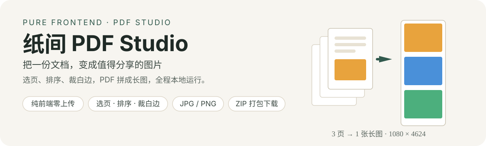
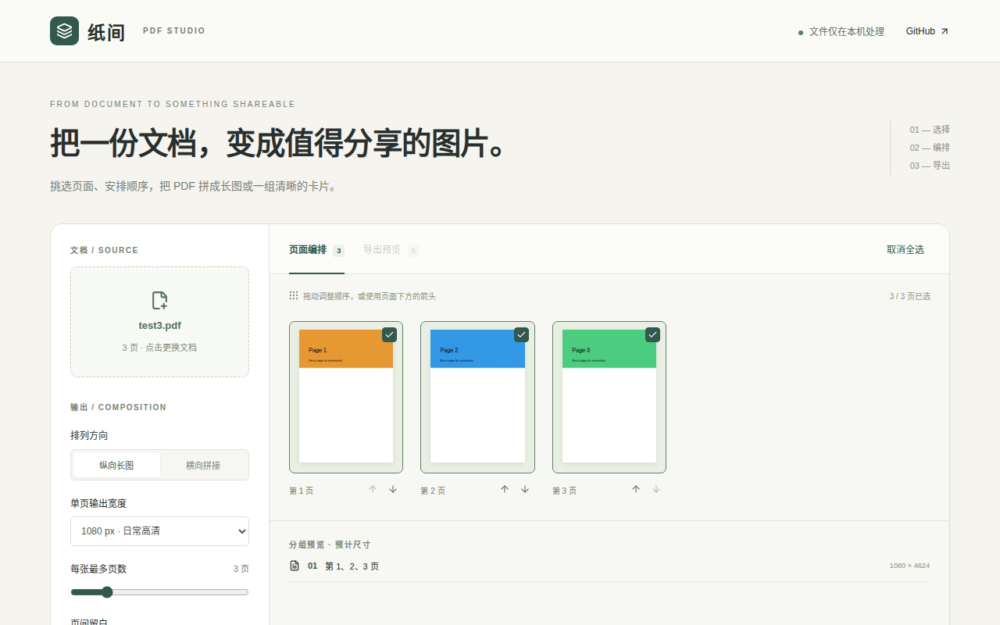
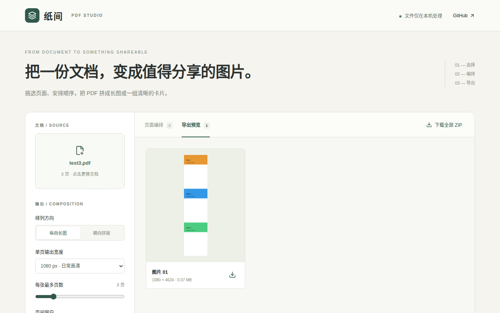

<p align="right"><a href="README.md">中文</a></p>

<p align="center">
  
</p>

<p align="center">
  <a href="https://xiaosang.cc/pdf2wechat/">▶ Try Online</a>
  ·
  <a href="https://github.com/holynova/pdf2wechat">GitHub Repository</a>
</p>

PDF Studio (pdf2wechat) is a pure-frontend PDF-to-long-image tool: pick pages, reorder them, trim whitespace, and stitch a PDF into long images or a set of crisp cards for sharing on WeChat and other social platforms — all in the browser, with no file upload.

## Screenshots

<p align="center">
  
  
</p>

## Usage

1. **Select**: import a PDF (max 300 pages); page thumbnails appear one by one.
2. **Arrange**: check the pages you want, drag or use the arrow buttons to reorder; uncheck pages you don't need.
3. **Export**: set output options, click 「生成图片」 ("Generate Images"), preview, then download single images or a ZIP.

## Output Options

| Option | Values | Default |
|---|---|---|
| Layout direction | Vertical long image / horizontal stitch | Vertical long image |
| Single-page output width | 750 / 1080 / 1600 / 2160 px | 1080 px |
| Max pages per image | Free input (slider) | 3 pages |
| Gap between pages | None / 20 px tight / 48 px loose | 20 px |
| Auto-trim whitespace | On / off | Off |
| Image format | JPG (smaller) / PNG (lossless) | JPG |

Groups auto-split at the per-image page count and canvas limits: 16,000 px max edge, 28 MP max pixels; exceeding either starts a new image. After trimming, the final size is whatever the preview shows. Generation is cancellable at any time; pages render and release canvases one by one, so large documents don't blow up memory.

Measured locally: a 3-page test PDF with defaults produced one 1080 × 4624 JPG (0.07 MB).

## Tech

- React 19 + Vite + TypeScript + Tailwind CSS 4; PDF decoding uses `pdfjs-dist` (worker bundled locally, no CDN dependency).
- Pure layout functions live in `src/workspace/layout.ts` (group planning, size math, canvas limits); `src/workspace/engine.ts` handles PDF decoding, whitespace trimming, export, and resource release.
- ZIP downloads use `jszip` + `file-saver`; state uses `zustand`.
- The legacy components (`src/components/`, `src/utils/pdfProcessor.ts`) and old screenshots (`snap_cn.png` / `snap_en.png`) belong to the v1 UI; the current `App.tsx` is the v2 workbench (see `docs/REBUILD.md`).

```
index.html                  Entry (title: 纸间 · PDF 分享图片工作台)
src/App.tsx                 v2 workbench: page selection / reordering / output settings / export preview
src/workspace/layout.ts     Pure layout: group planning, sizes, canvas limits
src/workspace/engine.ts     PDF decoding, whitespace trimming, export, ZIP, resource release
src/store/i18n.ts           Chinese–English UI copy
src/components/             v1 legacy components (currently unused)
src/utils/pdfProcessor.ts   v1 legacy processing logic (currently unused)
tests/layout.test.mjs       Layout tests (3 cases)
docs/REBUILD.md             v2 rebuild notes
docs/VALIDATION.md          Acceptance record (2026-11-16)
```

## Run Locally & Test

```bash
npm install
npm run dev      # Vite dev server
npm run build    # tsc + vite build, output to dist/
npm test         # node --test, 3 layout tests (verified passing locally)
```
